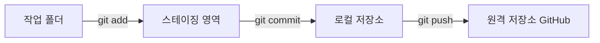

# gitexercise
git exercise sample

---

# 📘 마크다운(Markdown) 문법 완벽 가이드

> 마크다운은 **간단한 기호**로 문서의 서식을 지정하는 경량 마크업 언어입니다.
> GitHub의 `README.md`, 블로그, 노션, 디스코드 등 여러 곳에서 사용됩니다.

이 문서는 각 문법마다 **① 작성법(코드)** 과 **② 실제 결과** 를 함께 보여줍니다.

---

## 📑 목차

1. [제목 (Headings)](#1-제목-headings)
2. [문단과 줄바꿈](#2-문단과-줄바꿈)
3. [텍스트 강조](#3-텍스트-강조)
4. [인용문 (Blockquote)](#4-인용문-blockquote)
5. [목록 (List)](#5-목록-list)
6. [체크리스트 (Task List)](#6-체크리스트-task-list)
7. [코드 (Code)](#7-코드-code)
8. [링크 (Link)](#8-링크-link)
9. [이미지 (Image)](#9-이미지-image)
10. [표 (Table)](#10-표-table)
11. [수평선 (Horizontal Rule)](#11-수평선-horizontal-rule)
12. [이스케이프 문자](#12-이스케이프-문자)
13. [각주 (Footnote)](#13-각주-footnote)
14. [접기/펼치기 (details)](#14-접기펼치기-details)
15. [알림 박스 (GitHub Alerts)](#15-알림-박스-github-alerts)
16. [이모지 (Emoji)](#16-이모지-emoji)
17. [수식 (Math)](#17-수식-math)
18. [다이어그램 (Mermaid)](#18-다이어그램-mermaid)
19. [HTML 태그 사용](#19-html-태그-사용)
20. [주석 (보이지 않는 메모)](#20-주석-보이지-않는-메모)
21. [자주 하는 실수 모음](#21-자주-하는-실수-모음)
22. [한눈에 보는 요약표](#22-한눈에-보는-요약표)

---

## 1. 제목 (Headings)

`#` 기호의 **개수**로 제목의 크기(레벨)를 정합니다. 1개부터 6개까지 사용할 수 있습니다.

**작성법**

```markdown
# 제목 1 (가장 큼)
## 제목 2
### 제목 3
#### 제목 4
##### 제목 5
###### 제목 6 (가장 작음)
```

**결과**

# 제목 1 (가장 큼)
## 제목 2
### 제목 3
#### 제목 4
##### 제목 5
###### 제목 6 (가장 작음)

> 💡 **팁**
> - `#` 뒤에는 반드시 **띄어쓰기**를 한 칸 넣어야 합니다. (`#제목` ❌ → `# 제목` ✅)
> - 문서 전체 제목은 `#` 하나, 큰 단락은 `##`, 그 하위는 `###` 처럼 계층적으로 쓰는 것이 좋습니다.

**다른 방법 (제목 1, 2만 가능)**

```markdown
제목 1
======

제목 2
------
```

---

## 2. 문단과 줄바꿈

### 2-1. 문단 나누기

문장 사이에 **빈 줄을 하나** 넣으면 새로운 문단이 됩니다.

```markdown
첫 번째 문단입니다.

두 번째 문단입니다.
```

### 2-2. 같은 문단 안에서 줄바꿈

마크다운은 그냥 엔터를 한 번 치면 줄바꿈이 **무시**되는 경우가 많습니다. 줄을 바꾸고 싶다면 아래 방법 중 하나를 사용합니다.

| 방법 | 작성법 | 설명 |
|------|--------|------|
| 띄어쓰기 2칸 | `첫 줄␣␣` + 엔터 | 줄 끝에 스페이스 2개 (␣는 스페이스) |
| 백슬래시 | `첫 줄\` + 엔터 | 줄 끝에 `\` 붙이기 |
| HTML 태그 | `첫 줄<br>` | `<br>` 태그 사용 (표 안에서도 가능) |

**결과 예시**

첫 번째 줄<br>
두 번째 줄 (`<br>` 사용)

> 💡 **참고:** GitHub의 이슈·댓글에서는 엔터 한 번으로도 줄바꿈이 되지만, `README.md` 같은 파일에서는 위 방법을 써야 합니다.

---

## 3. 텍스트 강조

| 효과 | 작성법 | 결과 |
|------|--------|------|
| 굵게 | `**굵게**` 또는 `__굵게__` | **굵게** |
| 기울임 | `*기울임*` 또는 `_기울임_` | *기울임* |
| 굵게 + 기울임 | `***굵게 기울임***` | ***굵게 기울임*** |
| 취소선 | `~~취소선~~` | ~~취소선~~ |
| 인라인 코드 | `` `코드` `` | `코드` |
| 밑줄 (HTML) | `<ins>밑줄</ins>` | <ins>밑줄</ins> |
| 위 첨자 (HTML) | `x<sup>2</sup>` | x<sup>2</sup> |
| 아래 첨자 (HTML) | `H<sub>2</sub>O` | H<sub>2</sub>O |
| 키보드 키 (HTML) | `<kbd>Ctrl</kbd> + <kbd>C</kbd>` | <kbd>Ctrl</kbd> + <kbd>C</kbd> |

> 💡 **팁:** 한글 단어 중간에 강조를 넣을 때는 `_` 보다 `*` 가 더 잘 동작합니다.
> 예) `마크*다운*` → 마크*다운*

---

## 4. 인용문 (Blockquote)

줄 앞에 `>` 를 붙이면 인용문이 됩니다.

**작성법**

```markdown
> 이것은 인용문입니다.
> 여러 줄도 가능합니다.
>
> > 인용문 안에 인용문 (중첩)
> > > 3단계 중첩도 가능!
```

**결과**

> 이것은 인용문입니다.
> 여러 줄도 가능합니다.
>
> > 인용문 안에 인용문 (중첩)
> > > 3단계 중첩도 가능!

인용문 안에서 다른 마크다운 문법도 쓸 수 있습니다.

> ### 인용문 속 제목
> - **굵은 글씨**와 목록
> - `코드`도 사용 가능

---

## 5. 목록 (List)

### 5-1. 순서 없는 목록 (Unordered List)

`-`, `*`, `+` 중 하나를 사용합니다. (하나로 통일하는 것을 추천)

**작성법**

```markdown
- 사과
- 바나나
  - 노란 바나나
  - 초록 바나나
    - 더 깊은 단계
- 포도
```

**결과**

- 사과
- 바나나
  - 노란 바나나
  - 초록 바나나
    - 더 깊은 단계
- 포도

> 💡 **하위 목록**은 앞에 **띄어쓰기 2칸(또는 4칸)** 이나 **Tab**을 넣어 만듭니다.

### 5-2. 순서 있는 목록 (Ordered List)

숫자 뒤에 `.` 을 붙입니다.

**작성법**

```markdown
1. 첫 번째
2. 두 번째
   1. 두 번째의 하위 1
   2. 두 번째의 하위 2
3. 세 번째
```

**결과**

1. 첫 번째
2. 두 번째
   1. 두 번째의 하위 1
   2. 두 번째의 하위 2
3. 세 번째

> 💡 **재미있는 사실:** 숫자를 모두 `1.` 로 적어도 자동으로 1, 2, 3… 순서가 매겨집니다.
> 시작 번호는 첫 번째 숫자를 따릅니다. (예: `5.` 로 시작하면 5, 6, 7…)

### 5-3. 목록 안에 다른 요소 넣기

목록 항목 아래에 들여쓰기를 맞추면 문단, 코드 블록 등을 넣을 수 있습니다.

```markdown
1. 저장소를 복제합니다.

   ```bash
   git clone https://github.com/사용자명/저장소.git
   ```

2. 폴더로 이동합니다.
```

---

## 6. 체크리스트 (Task List)

`- [ ]` 는 빈 체크박스, `- [x]` 는 체크된 박스입니다.

**작성법**

```markdown
- [x] Git 설치하기
- [x] 저장소 만들기
- [ ] 첫 커밋 하기
- [ ] 브랜치 만들어 보기
```

**결과**

- [x] Git 설치하기
- [x] 저장소 만들기
- [ ] 첫 커밋 하기
- [ ] 브랜치 만들어 보기

> ⚠️ `[ ]` 안에는 **띄어쓰기 한 칸**이 꼭 있어야 합니다. (`[]` ❌ → `[ ]` ✅)

---

## 7. 코드 (Code)

### 7-1. 인라인 코드

문장 안에서 짧은 코드는 백틱(`` ` ``)으로 감쌉니다.

```markdown
터미널에서 `git status` 를 입력하세요.
```

결과: 터미널에서 `git status` 를 입력하세요.

> 💡 백틱 키는 키보드 왼쪽 위 <kbd>Esc</kbd> 아래, <kbd>1</kbd> 왼쪽에 있습니다. (`~` 와 같은 키)

코드 안에 백틱이 들어가야 한다면 백틱 **2개**로 감쌉니다: ``` `` `백틱` `` ``` → `` `백틱` ``

### 7-2. 코드 블록

백틱 **3개**(```` ``` ````)로 위아래를 감싸고, 첫 줄에 **언어 이름**을 적으면 문법 색상(하이라이팅)이 적용됩니다.

**작성법**

````markdown
```python
def hello(name):
    print(f"안녕하세요, {name}님!")

hello("홍길동")
```
````

**결과**

```python
def hello(name):
    print(f"안녕하세요, {name}님!")

hello("홍길동")
```

**자주 쓰는 언어 이름**

| 언어 | 이름 | 언어 | 이름 |
|------|------|------|------|
| 파이썬 | `python` | 자바스크립트 | `javascript` / `js` |
| 자바 | `java` | 타입스크립트 | `typescript` / `ts` |
| C / C++ | `c` / `cpp` | HTML / CSS | `html` / `css` |
| 쉘 명령어 | `bash` / `shell` | JSON | `json` |
| SQL | `sql` | 마크다운 | `markdown` / `md` |
| 변경 사항 | `diff` | 일반 텍스트 | `text` |

**`diff` 예시** (추가/삭제 표시)

```diff
- 삭제된 줄
+ 추가된 줄
  변경 없는 줄
```

> 💡 코드 블록 안에 ```` ``` ```` 를 보여주고 싶다면, 바깥을 백틱 **4개**(```` ```` ````)로 감싸면 됩니다.
> 또는 물결표 `~~~` 로 감싸는 방법도 있습니다.

### 7-3. 들여쓰기 코드 블록

줄 앞에 **스페이스 4칸**을 넣어도 코드 블록이 됩니다. (색상 지정 불가, 잘 안 씀)

    이것도 코드 블록입니다.

---

## 8. 링크 (Link)

### 8-1. 기본 링크

```markdown
[표시될 글자](https://github.com)
[마우스를 올리면 설명이 보여요](https://github.com "GitHub 홈페이지")
```

결과: [표시될 글자](https://github.com) / [마우스를 올리면 설명이 보여요](https://github.com "GitHub 홈페이지")

### 8-2. URL 자동 링크

```markdown
<https://www.google.com>
<example@email.com>
```

결과: <https://www.google.com>

> 💡 GitHub에서는 `https://...` 주소만 적어도 자동으로 링크가 됩니다.

### 8-3. 참조형 링크

긴 주소를 문서 아래쪽에 모아 둘 수 있어 본문이 깔끔해집니다.

```markdown
[구글][1]과 [네이버][naver]를 방문하세요.

[1]: https://www.google.com
[naver]: https://www.naver.com
```

결과: [구글][1]과 [네이버][naver]를 방문하세요.

[1]: https://www.google.com
[naver]: https://www.naver.com

### 8-4. 문서 내부 이동 (앵커 링크)

제목으로 바로 이동하는 링크를 만들 수 있습니다. 위의 **목차**가 이 방식입니다.

```markdown
[제목 섹션으로 이동](#1-제목-headings)
```

**앵커 이름 만드는 규칙**
1. 제목을 모두 **소문자**로 바꿉니다.
2. **띄어쓰기는 `-`** 로 바꿉니다.
3. `.`, `(`, `)`, `/` 같은 **특수문자는 제거**합니다. (한글은 그대로 유지)

예) `## 1. 제목 (Headings)` → `#1-제목-headings`

결과: [맨 위 목차로 이동](#-목차)

### 8-5. 다른 파일로 링크

```markdown
[라이선스 보기](LICENSE)
[docs 폴더의 가이드](docs/guide.md)
```

---

## 9. 이미지 (Image)

링크 문법 앞에 `!` 를 붙이면 이미지가 됩니다.

**작성법**

```markdown

```

**예시**

```markdown

```

**결과**


> 💡 **대체 텍스트**는 이미지가 안 보일 때 대신 표시되고, 시각장애인용 화면 낭독기가 읽어 줍니다.

### 9-1. 이미지 크기 조절 (HTML 사용)

마크다운 자체로는 크기 조절이 안 되므로 HTML `` 태그를 사용합니다.

```html

```


### 9-2. 이미지에 링크 걸기

```markdown
[](https://github.com)
```

### 9-3. 저장소 안의 이미지 사용

```markdown

```

---

## 10. 표 (Table)

`|` (파이프)로 칸을 나누고, 두 번째 줄에 `---` 로 머리글과 내용을 구분합니다.

**작성법**

```markdown
| 이름   | 나이 | 직업     |
|--------|------|----------|
| 홍길동 | 25   | 개발자   |
| 김철수 | 30   | 디자이너 |
```

**결과**

| 이름   | 나이 | 직업     |
|--------|------|----------|
| 홍길동 | 25   | 개발자   |
| 김철수 | 30   | 디자이너 |

### 10-1. 정렬하기

구분선에 `:` (콜론)을 붙이는 위치로 정렬을 정합니다.

```markdown
| 왼쪽 정렬 | 가운데 정렬 | 오른쪽 정렬 |
|:----------|:-----------:|------------:|
| 사과      | 바나나      | 1,000원     |
| 포도      | 수박        | 15,000원    |
```

| 왼쪽 정렬 | 가운데 정렬 | 오른쪽 정렬 |
|:----------|:-----------:|------------:|
| 사과      | 바나나      | 1,000원     |
| 포도      | 수박        | 15,000원    |

| 기호 | 정렬 |
|------|------|
| `:---` | 왼쪽 (기본값) |
| `:---:` | 가운데 |
| `---:` | 오른쪽 |

> 💡 **팁**
> - 칸 너비를 꼭 맞출 필요는 없습니다. `|-|-|` 처럼 짧게 써도 됩니다.
> - 표 안에서 `|` 글자를 쓰려면 `\|` 로 적습니다.
> - 표 안에서 줄바꿈은 `<br>` 을 사용합니다.
> - 표 안에서도 **굵게**, `코드`, [링크](#) 등을 쓸 수 있습니다.

---

## 11. 수평선 (Horizontal Rule)

아래 세 가지 모두 같은 가로줄을 만듭니다. (3개 이상)

```markdown
---
***
___
```

결과:

---

> ⚠️ 글자 바로 아래 줄에 `---` 를 쓰면 **제목 2**로 바뀝니다! 수평선을 쓰려면 위에 **빈 줄**을 꼭 넣으세요.

---

## 12. 이스케이프 문자

마크다운 기호를 **글자 그대로** 보여주고 싶을 때는 앞에 백슬래시(`\`)를 붙입니다.

```markdown
\*별표가 그대로 보여요\*
\# 제목이 아니에요
1\. 목록이 아니에요
```

결과:

\*별표가 그대로 보여요\*

\# 제목이 아니에요

1\. 목록이 아니에요

**이스케이프 가능한 문자들**

```
\   백슬래시        `   백틱           *   별표
_   언더바          {}  중괄호         []  대괄호
()  소괄호          #   샵             +   더하기
-   빼기(하이픈)    .   마침표         !   느낌표
|   파이프          <>  꺾쇠
```

---

## 13. 각주 (Footnote)

본문에 `[^이름]` 을 적고, 문서 어딘가에 `[^이름]: 설명` 을 적으면 문서 맨 아래에 각주가 생깁니다.

**작성법**

```markdown
Git은 리누스 토르발스가 만들었습니다.[^1]
마크다운은 2004년에 등장했습니다.[^md]

[^1]: 리눅스 커널을 만든 사람이기도 합니다.
[^md]: 존 그루버(John Gruber)가 만들었습니다.
```

**결과**

Git은 리누스 토르발스가 만들었습니다.[^1]
마크다운은 2004년에 등장했습니다.[^md]

[^1]: 리눅스 커널을 만든 사람이기도 합니다.
[^md]: 존 그루버(John Gruber)가 만들었습니다.

---

## 14. 접기/펼치기 (details)

HTML의 `<details>` 와 `<summary>` 태그로 클릭하면 열리는 영역을 만들 수 있습니다.

**작성법**

```html
<details>
<summary>👉 클릭해서 정답 보기</summary>

정답은 **42** 입니다!

- 안에서도 마크다운 사용 가능
- 단, `<summary>` 다음에 **빈 줄**이 있어야 합니다.

</details>
```

**결과**

<details>
<summary>👉 클릭해서 정답 보기</summary>

정답은 **42** 입니다!

- 안에서도 마크다운 사용 가능
- 단, `<summary>` 다음에 **빈 줄**이 있어야 합니다.

</details>

> 💡 처음부터 펼쳐진 상태로 두려면 `<details open>` 이라고 씁니다.

---

## 15. 알림 박스 (GitHub Alerts)

GitHub에서만 지원하는 문법으로, 색깔 있는 강조 박스를 만듭니다.

**작성법**

```markdown
> [!NOTE]
> 참고할 만한 정보입니다.

> [!TIP]
> 알아두면 좋은 팁입니다.

> [!IMPORTANT]
> 꼭 알아야 하는 중요한 내용입니다.

> [!WARNING]
> 주의가 필요한 내용입니다.

> [!CAUTION]
> 위험할 수 있는 행동에 대한 경고입니다.
```

**결과**

> [!NOTE]
> 참고할 만한 정보입니다.

> [!TIP]
> 알아두면 좋은 팁입니다.

> [!IMPORTANT]
> 꼭 알아야 하는 중요한 내용입니다.

> [!WARNING]
> 주의가 필요한 내용입니다.

> [!CAUTION]
> 위험할 수 있는 행동에 대한 경고입니다.

---

## 16. 이모지 (Emoji)

GitHub에서는 `:이름:` 형식으로 이모지를 넣을 수 있습니다. (이모지를 직접 붙여 넣어도 됩니다 😀)

| 작성법 | 결과 | 작성법 | 결과 |
|--------|------|--------|------|
| `:smile:` | :smile: | `:rocket:` | :rocket: |
| `:+1:` | :+1: | `:fire:` | :fire: |
| `:heart:` | :heart: | `:bug:` | :bug: |
| `:white_check_mark:` | :white_check_mark: | `:x:` | :x: |
| `:warning:` | :warning: | `:bulb:` | :bulb: |
| `:memo:` | :memo: | `:tada:` | :tada: |

> 💡 전체 목록: <https://gist.github.com/rxaviers/7360908>

---

## 17. 수식 (Math)

GitHub는 LaTeX 수식을 지원합니다.

**문장 안 수식** — `$` 로 감싸기

```markdown
피타고라스 정리는 $a^2 + b^2 = c^2$ 입니다.
```

결과: 피타고라스 정리는 $a^2 + b^2 = c^2$ 입니다.

**독립된 수식 블록** — `$$` 로 감싸기

```markdown
$$
x = \frac{-b \pm \sqrt{b^2 - 4ac}}{2a}
$$
```

결과:

$$
x = \frac{-b \pm \sqrt{b^2 - 4ac}}{2a}
$$

---

## 18. 다이어그램 (Mermaid)

코드 블록의 언어를 `mermaid` 로 지정하면 GitHub에서 그림(다이어그램)으로 그려 줍니다.

**작성법**

````markdown

````

**결과**


---

## 19. HTML 태그 사용

마크다운 안에서 HTML을 섞어 쓸 수 있습니다. (GitHub는 보안상 일부 태그·스타일만 허용)

```html
<p align="center">
  <b>가운데 정렬된 굵은 글씨</b>
</p>

<mark>형광펜 효과</mark> (일부 환경에서만 지원)
```

<p align="center">
  <b>가운데 정렬된 굵은 글씨</b>
</p>

> ⚠️ GitHub에서는 `style="color:red"` 같은 **CSS 스타일은 무시**됩니다.

---

## 20. 주석 (보이지 않는 메모)

HTML 주석을 쓰면 화면에는 보이지 않는 메모를 남길 수 있습니다.

```markdown
<!-- 이 내용은 화면에 보이지 않습니다 -->
```

<!-- 여기에 주석이 있지만 화면에는 보이지 않아요! -->

결과: (바로 위에 주석이 있지만 아무것도 보이지 않습니다 👀)

---

## 21. 자주 하는 실수 모음

| ❌ 잘못된 예 | ✅ 올바른 예 | 이유 |
|-------------|-------------|------|
| `#제목` | `# 제목` | `#` 뒤에 띄어쓰기 필요 |
| `-항목` | `- 항목` | `-` 뒤에 띄어쓰기 필요 |
| `- []할 일` | `- [ ] 할 일` | 대괄호 안에 띄어쓰기 필요 |
| `**굵게 **` | `**굵게**` | 기호 안쪽에 공백이 있으면 안 됨 |
| 문단 바로 아래 `---` | 빈 줄 후 `---` | 제목 2로 바뀌어 버림 |
| 목록 바로 앞에 문장 | 문장 뒤 빈 줄 후 목록 | 일부 환경에서 목록이 인식 안 됨 |
| `![이미지] (주소)` | `` | `]` 와 `(` 사이에 공백 금지 |
| 엔터 한 번으로 줄바꿈 | 줄 끝 스페이스 2칸 / `<br>` | 엔터 한 번은 무시됨 |

---

## 22. 한눈에 보는 요약표

| 기능 | 문법 |
|------|------|
| 제목 | `# H1` ~ `###### H6` |
| 굵게 | `**텍스트**` |
| 기울임 | `*텍스트*` |
| 취소선 | `~~텍스트~~` |
| 인라인 코드 | `` `코드` `` |
| 코드 블록 | ```` ```언어 ```` ... ```` ``` ```` |
| 인용문 | `> 텍스트` |
| 순서 없는 목록 | `- 항목` |
| 순서 있는 목록 | `1. 항목` |
| 체크리스트 | `- [ ]` / `- [x]` |
| 링크 | `[글자](주소)` |
| 이미지 | `` |
| 표 | `\| 칸 \| 칸 \|` + `\|---\|---\|` |
| 수평선 | `---` |
| 줄바꿈 | 줄 끝 스페이스 2칸 / `\` / `<br>` |
| 이스케이프 | `\*` |
| 각주 | `[^1]` + `[^1]: 설명` |
| 접기 | `<details><summary>제목</summary>내용</details>` |
| 알림 박스 | `> [!NOTE]` |
| 이모지 | `:smile:` |
| 수식 | `$수식$` / `$$수식$$` |
| 다이어그램 | ```` ```mermaid ```` |
| 주석 | `<!-- 메모 -->` |

---

<p align="center">
  ✍️ 직접 이 파일을 고쳐 보면서 연습해 보세요! <br>
  VS Code에서 <kbd>Ctrl</kbd> + <kbd>Shift</kbd> + <kbd>V</kbd> 를 누르면 <b>미리보기</b>를 볼 수 있습니다.
</p>
